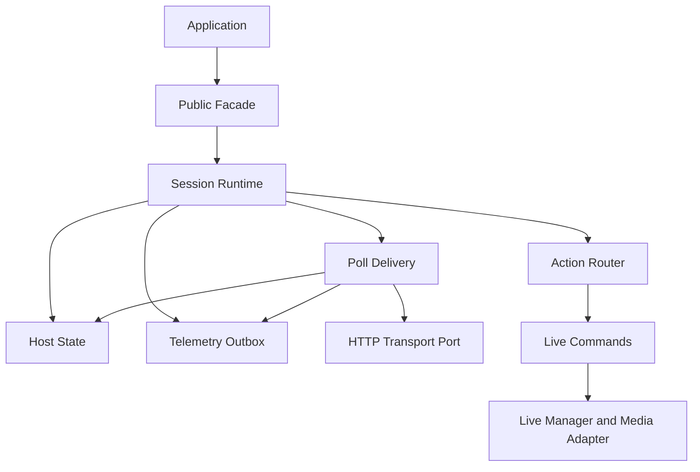

# SDK architecture

The public `OpButtonSDK` API is a Facade. It keeps initialization and convenience calls compatible while delegating mutable state to one internal `OpButtonRuntime` per initialization.

## Responsibilities

| Component | Owns |
| --- | --- |
| `OpButtonRuntime` | Composition of collaborators, connection/approval/recovery, scheduling, session status and listener registration |
| `OpButtonHostState` | Reading host providers, detached panel/attribute snapshots and acknowledgement of captured revisions/values |
| `OpButtonPollDelivery` | One delivery exchange through narrow `Transport` and `State` ports; panel failure reporting and telemetry settlement |
| `OpButtonTelemetry` | Bounded log outbox, log attributes, metric batches, terminal flushing and a delivery receipt |
| `OpButtonActionRouter` | Immutable command catalogue, widget dispatch and an Observer snapshot for application listeners |
| `OpButtonLiveCommands` | Media command implementations, injected execution strategy and acknowledgements bound to the action's session |

The ports are internal. No service locator, reflection-based dependency discovery, dependency injection container or new package dependency is required. The composition root constructs its collaborators explicitly. The Unity media adapter remains a separate optional assembly.

## Delivery contract

1. Capture detached host state before taking telemetry out of its queue.
2. Submit the panel and acknowledge its captured revision only after success in the current session. A failed panel remains pending and action polling continues.
3. Take a telemetry receipt, send the attribute snapshot, logs and metrics together.
4. On success, acknowledge the captured attributes if the session is still current, then commit the receipt.
5. On any unfinished exchange, roll back the receipt exactly once. Entries arriving during the request remain after the restored older entries, within the configured buffer limit.

A receipt can be settled once. Closing/rolling back an already committed receipt does nothing. A recovery probe sends no outbox data and returns its response to the same session-aware command path as ordinary polling. It never consumes pending telemetry or advances host state.

This is an in-memory transactional outbox. Transport success does not promise exactly-once server processing: a lost HTTP response can still cause a retry of data already accepted by the server.

## Command contract

The router copies its command catalogue at construction. Reserved commands execute exclusively. Application actions go through the widget handler and then a snapshot of registered observers. Listeners may detach during notification without changing the current iteration. On platforms with throwing callbacks, one callback failure is isolated from the remaining observers.

The action's session token is passed explicitly to its command. Background media operations check that session before execution and before acknowledgement. They use their runtime's acknowledgement dependency, preserving ownership across disconnect/reinitialization.

To add a reserved command, add its typed action and register a command implementation at the composition root. Polling and retry loops do not need another branch. To test delivery, replace the small transport/state ports while keeping the real telemetry outbox and acknowledgement journal.

## Threading and lifetime

Host UI access and action callbacks retain each platform's documented thread contract. `OpButtonHostState` contains platform dispatch details; HTTP works with detached data. Metric collection remains with `OpButtonMetrics`; its samples participate in telemetry receipts.

OpButtonSessionWork owns cancellation and timer subscriptions. Closing it releases pending host-thread waits and rejects late subscriptions. A paused Unity host leaves the outbox intact. Stopping live never waits for the main thread from that same thread; active pointer gestures are cancelled without a click.

The design deliberately uses collaborators, copies and snapshots to keep ownership explicit. Allocation reduction should preserve these boundaries and be justified by measurements.

## Session identity

The SDK generates a random `run_id` for each initialized runtime. It is not saved with the device ID. Connection retries, approval polling and network recovery keep that ID. Reinitializing the SDK starts another run, creates a new server session and closes the previous session for that device. A retired run cannot reconnect into the replacement session. An explicit disconnect or a server timeout can close a session within a run; reconnecting then creates a fresh session for that same run.

The server expires sessions after five minutes without an authenticated client request. Recovery before expiration keeps the session and its token. Older clients without `run_id` retain legacy behavior until the device uses run identity; afterwards a client that omits the ID receives HTTP 409 rather than joining another run.

## Contract tests

`RuntimeContractsTests.cs` covers failed-delivery ordering, acknowledgements from an old session, panel failure independence, non-consuming probes, idempotent receipts and command/observer isolation. Existing recovery, panel revision and identity/input tests continue to exercise the surrounding SDK.
